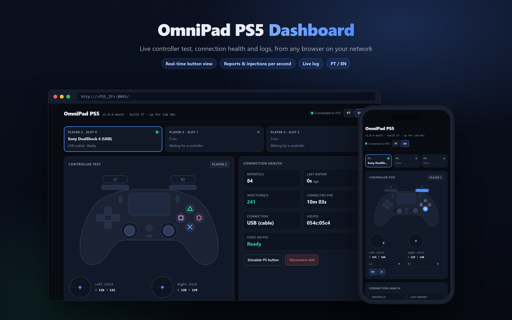

# OmniPad PS5

Use third-party controllers on a jailbroken PS5 (FW 7.00 – 13.60). They plug in over USB, connect through a 2.4 GHz dongle, or connect over Bluetooth through a USB adapter. Each one shows up on the console as a DualSense for players 2 to 4.

[](docs/FIRMWARE_1360_GUIDE.md)
[](src/)
[](LICENSE)

**Em português: [Comece aqui](docs/COMECE_AQUI.md)**, o passo a passo e o que fazer se não funcionar.

> This is a community fork of [diegobarbosaa/OmniPad-PS5](https://github.com/diegobarbosaa/OmniPad-PS5). It adds:
>
> - Bluetooth controllers through your own USB adapter, so the DualSense keeps the console's internal radio.
> - The 8BitDo Ultimate 2C.
> - A new web dashboard.
> - One driver per controller model.

---

## What works

| Controller | Connection | Status |
|---|---|:---:|
| Sony DualShock 4 (CUH-ZCT1) | Bluetooth, through a USB adapter | ✅ Tested on a PS5, FW 13.60 |
| Sony DualShock 4 (CUH-ZCT1) | USB cable | ✅ Tested on a PS5, FW 13.60 |
| 8BitDo Ultimate 2C | 2.4 GHz dongle or USB-C cable | ✅ Tested on a PS5, FW 13.60 |
| Machenike G5 Pro / G5 Pro Max SE | 2.4 GHz dongle or USB-C cable | ✅ Tested upstream |
| Xbox One / Series, Xbox 360, DualShock 3, Switch Pro, generic USB pads | USB cable | 🟡 Written from the spec, not yet tested on a console |
| Other Bluetooth pads (Switch Pro, 8BitDo, Xbox BLE, generic HID) | Bluetooth, through a USB adapter | 🟡 Profiles exist, not yet tested on a console |

The official DualSense stays player 1 on the console's own radio. OmniPad never touches that radio.

Not supported: adaptive triggers and haptics on non-DualSense pads, the touchpad as a surface (it works as a single click), and the Microsoft Xbox Wireless Adapter dongle.

Full tables with VID:PID: [docs/COMPATIBILITY.md](docs/COMPATIBILITY.md).

---

## Quick start

1. Download `OmniPad-PS5.elf` from [Releases](../../releases).
2. Send it to the PS5 with your payload loader **and start it** (in PLK, press **Launch**). A notification "OmniPad ... ativo" confirms it is running. No notification means it did not start.
3. Connect a controller:
   - **USB cable or 2.4 GHz dongle:** plug it into any USB port.
   - **Bluetooth:** plug a USB Bluetooth adapter into the PS5 (see below), then put the controller in pairing mode. On a DS4, hold Share + PS until the light flashes fast. OmniPad finds it by itself. Next time, pressing PS is enough.
4. Press PS on the controller and pick a profile on the screen that appears.

---

## Bluetooth adapter

The PS5 has only one Bluetooth radio, and the DualSense needs it. Sharing it with the system leaves the DualSense stuck until a restart. So OmniPad drives a second, ordinary USB Bluetooth adapter instead.

| Adapter | Chip | Status |
|---|---|:---:|
| TP-Link UB500 (`2357:0604`) | Realtek RTL8761BU | ✅ Tested. OmniPad loads its firmware by itself. |
| Other RTL8761B / RTL8761BU adapters | Realtek RTL8761B | Should work: same chip and firmware |
| Adapters that need no firmware (most CSR8510, some Broadcom) | various | Should work, not yet tested |
| Other Realtek chips (RTL8821C, RTL8822B, …) | Realtek | Not yet: they need their own firmware |

The adapter can stay plugged in all the time. While no Bluetooth controller is connected, OmniPad keeps searching for pads in pairing mode. Once one is connected, it only takes a quick look every 20 seconds.

---

## Dashboard

On the PS5 itself, open the **OmniPad** icon in the **Media** tab. It is installed the first time OmniPad runs, and it works while OmniPad is running. From a phone or PC on the same network, open `http://<PS5_IP>:8095/`. The start notification shows the IP.



- **Controller test:** a DualSense drawing lights up the buttons, sticks and triggers you press.
- **Connection health:** reports per second, time since the last report and the slot state on the console.
- **Bluetooth:** the adapter, its address, the paired and connected pads, plus buttons to pair or to forget the paired pads.
- **Live log:** with filters for USB, Bluetooth, slots and errors.
- **Actions:** simulate the PS button, free a slot, or stop OmniPad.
- **Copy diagnostics:** the version, controllers, Bluetooth state and the end of the log in one text, to paste when asking for help.

Light and dark themes, Portuguese and English.

---

## Building

You need the [ps5-payload-sdk](https://github.com/ps5-payload-dev/sdk). On Windows, `tools/setup-wsl-toolchain.sh` installs it in WSL Ubuntu.

```bash
sh tools/get-bt-firmware.sh
```

```bash
export PS5_PAYLOAD_SDK=/opt/ps5-payload-sdk && make
```

```bash
make test
```

`get-bt-firmware.sh` downloads the Realtek firmware from linux-firmware into `firmware/`. That folder is not in the repository. Without it, the build still works, but RTL8761B adapters stay on their factory firmware and won't find any pads.

More detail: [docs/HOW_IT_WORKS.md](docs/HOW_IT_WORKS.md) and [docs/FIRMWARE_1360_GUIDE.md](docs/FIRMWARE_1360_GUIDE.md).

---

## Credits and licences

OmniPad is GPL-3.0. It builds on:

- **diegobarbosaa:** the original [OmniPad-PS5](https://github.com/diegobarbosaa/OmniPad-PS5).
- **sinfiltros:** [AnyPad-PS5](https://github.com/sinfiltros/AnyPad-PS5). The Bluetooth host in `src/bt/` comes from it, through the BearTS fork and upstream pull request 18. See [src/bt/README.md](src/bt/README.md).
- **StonedModder / a-ddr:** [PoorDS4](https://github.com/a-ddr/PoorDS4) and Ghostcontrol, for USB HID parsing.
- **MegaCadeDev:** [YetAnotherControllerEnabler](https://github.com/MegaCadeDev/YetAnotherControllerEnabler), for the profile screen work in `SceShellUI`.
- **The ps5-payload-sdk, kstuff and etaHEN teams.**

The released ELF carries Realtek's RTL8761BU Bluetooth firmware from linux-firmware. Realtek's licence allows that; its notice is in [docs/THIRD_PARTY.md](docs/THIRD_PARTY.md).

This is an independent project for interoperability and accessibility. It has no Sony code, no DRM circumvention and no keys. Product names belong to their owners.
