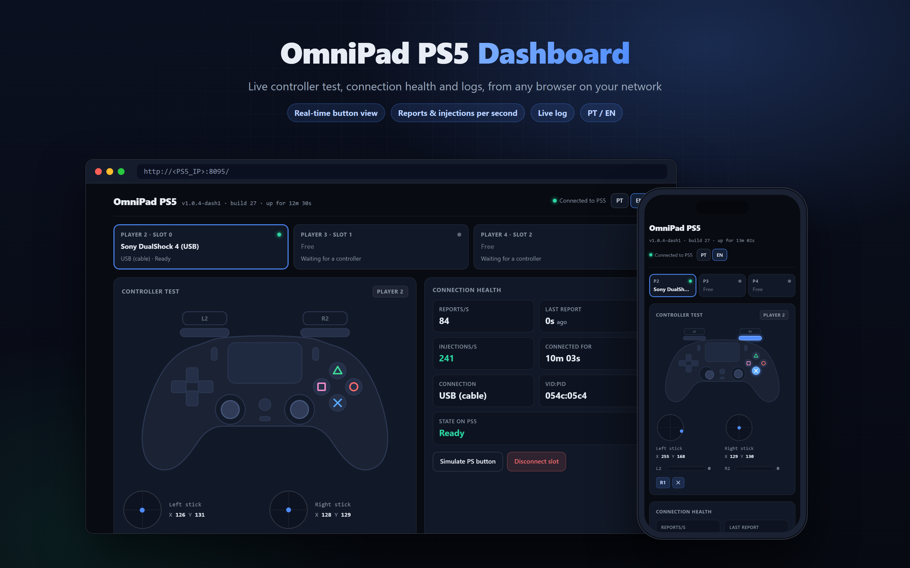

# OmniPad CE (Community Edition)

Use third-party controllers on a jailbroken PS5 (FW 7.00 – 13.60). They plug in over USB, connect through a 2.4 GHz dongle, or connect over Bluetooth through a USB adapter. Each one shows up on the console as a DualSense for players 2 to 4.

[](docs/FIRMWARE_1360_GUIDE.md)
[](src/)
[](LICENSE)

**Em português: [Comece aqui](docs/COMECE_AQUI.md)**, o passo a passo e o que fazer se não funcionar.

> OmniPad CE is the community-maintained continuation of [diegobarbosaa/OmniPad-PS5](https://github.com/diegobarbosaa/OmniPad-PS5), which has had no activity since early October 2026. It adds:
>
> - Bluetooth controllers through your own USB adapter, so the DualSense keeps the console's internal radio.
> - The 8BitDo Ultimate 2C.
> - A dashboard that also opens on the PS5 itself, from the Media tab.
> - Notifications and dashboard in the console's language (7 languages), and a Portuguese guide.
> - One driver per controller model.
>
> Bugs and requests go to [Issues](https://github.com/jpemendonca/OmniPad-CE/issues). Paste the dashboard's **Copy diagnostics** text into them, or press **Something wrong? Send a report** on the dashboard and quote the code it gives you.

---

## What works

| Controller | Connection | Status |
|---|---|:---:|
| Sony DualShock 4 (CUH-ZCT1) | Bluetooth, through a USB adapter | ✅ Tested on a PS5, FW 13.60 |
| Sony DualShock 4 (CUH-ZCT1) | USB cable | ✅ Tested on a PS5, FW 13.60 |
| 8BitDo Ultimate 2C | 2.4 GHz dongle or USB-C cable | ✅ Tested on a PS5, FW 13.60 |
| Machenike G5 Pro / G5 Pro Max SE | 2.4 GHz dongle or USB-C cable | ✅ Tested upstream |
| GameSir G7 Pro 8K | 2.4 GHz dongle | ✅ Reported working by the community |
| Sony DualShock 4 through an 8BitDo USB Wireless Adapter 2 | USB adapter | ✅ Tested on a PS5, FW 13.60 |
| Xbox Series X\|S | USB cable | ✅ Tested on a PS5, FW 13.60 |
| Xbox Series X\|S | Bluetooth, through a USB adapter | ✅ Tested on a PS5, FW 13.60 |
| Xbox One, Xbox 360, DualShock 3, Switch Pro, generic USB pads | USB cable | 🟡 Written from the spec, not yet tested on a console |
| Nintendo Joy-Con (original), always the two together as one controller | Bluetooth, through a USB adapter | ✅ Tested on a PS5, FW 13.60, on a TP-Link UB500 and a generic CSR adapter, and confirmed by the community |
| Other Bluetooth pads (Switch Pro, 8BitDo, generic HID) | Bluetooth, through a USB adapter | 🟡 Profiles exist, not yet tested on a console |

The official DualSense stays player 1 on the console's own radio. OmniPad never touches that radio.

Not supported: adaptive triggers and haptics on non-DualSense pads, the touchpad as a surface (it works as a single click), and the Microsoft Xbox Wireless Adapter dongle.

Full tables with VID:PID: [docs/COMPATIBILITY.md](docs/COMPATIBILITY.md).

---

## Quick start

1. Download `OmniPad-CE.elf` from [Releases](../../releases).
2. Get it to the PS5 **and start it**. Sending the file is not enough. Any payload loader works, and these are common:
   - **Prospero Manager:** send `OmniPad-CE.elf`, then press **Launch**.
   - **USB drive and a payload manager:** copy `OmniPad-CE.elf` to the root of a USB drive formatted as exFAT, plug it into the PS5, and start it from your payload manager.
   - **PLK Payload Manager:** send `OmniPad-CE.elf`, then press **Launch**.

   A notification "OmniPad ... running" confirms it started. No notification means it did not start.
3. Connect a controller:
   - **USB cable or 2.4 GHz dongle:** plug it into any USB port.
   - **Bluetooth:** plug a USB Bluetooth adapter into the PS5 (see below), then put the controller in pairing mode. On a DS4, hold Share + PS until the light flashes fast. OmniPad finds it by itself. Next time, pressing PS is enough.
4. Press PS on the controller and pick a profile on the screen that appears.

---

## Bluetooth adapter

The PS5 has only one Bluetooth radio, and the DualSense needs it. Sharing it with the system leaves the DualSense stuck until a restart. So OmniPad drives a second, ordinary USB Bluetooth adapter instead.

| Adapter | Chip | Status |
|---|---|:---:|
| TP-Link UB500 (`2357:0604`) | Realtek RTL8761BU | ✅ Tested. OmniPad loads its firmware by itself. |
| Other RTL8761B / RTL8761BU adapters | Realtek RTL8761B | Should work: same chip and firmware |
| Generic "CSR 4.0" dongles, Baseus included (`0a12:0001`, CSR8510 clones) | CSR8510 clone | ⚠️ Tested, with limits. One pad works. Searching for a second pad while one is playing can lock the chip up: both drop, and OmniPad resets it or asks you to replug it. |
| Other adapters that need no firmware (genuine CSR8510, some Broadcom) | various | Should work, not yet tested |
| Other Realtek chips (RTL8821C, RTL8822B, …) | Realtek | Not yet: they need their own firmware |

For more than one Bluetooth pad, prefer an RTL8761B adapter. The adapter can stay plugged in all the time. While no Bluetooth controller is connected, OmniPad keeps searching for pads in pairing mode. Once one is connected, it only takes a quick look every 20 seconds (never on CSR8510 clones; use **Pair controller** in the dashboard for a second pad there).

---

## Mapping buttons (optional)

Nobody has to do this: controllers work as they are. To change a button, press **Map buttons** next to the controller drawing on the dashboard, click a button in the drawing, and press on your controller what should become it within 10 seconds. Pressing two together makes a combo, so a pad with no touchpad button can have it on L3 + R3. Changes apply to that controller model and stay saved, and **Restore everything to default** undoes them. PS can be set as a result, but the physical PS button cannot be moved, so nobody loses the way to the profile screen.

## Dashboard

On the PS5 itself, open the **OmniPad** icon in the **Media** tab. It is installed the first time OmniPad runs, and it works while OmniPad is running. From a phone or PC on the same network, open `http://<PS5_IP>:8105/`. The start notification shows the IP.



- **Controller test:** a DualSense drawing lights up the buttons, sticks and triggers you press.
- **Connection health:** reports per second, time since the last report, battery and the slot state on the console. Pads that do not report their battery say so, instead of showing a made-up level.
- **Bluetooth:** the adapter, its address, the paired and connected pads, plus buttons to pair or to forget the paired pads.
- **Live log:** with filters for USB, Bluetooth, slots and errors.
- **Actions:** simulate the PS button, free a slot, or stop OmniPad.
- **Copy diagnostics:** the version, controllers, Bluetooth state and the end of the log in one text, to paste when asking for help.
- **Send a report:** the button at the top right sends the log and the diagnostics to the developer, with a message if you want to add one. You get a short code to quote on GitHub or Reddit.

**Sending a report.** Nothing leaves your console unless you press Send. A report holds the OmniPad log, the diagnostics text (slots, controllers, Bluetooth adapter), the OmniPad version and build, the console firmware, and the message you choose to add. MAC addresses are cut to their first three bytes, the part that names the maker, before the report is saved. Reports go to a small API run by the maintainer on Cloudflare Workers and are stored in a Cloudflare database. Only the maintainer, and the AI tools used to develop OmniPad, read them. Each report is deleted after 90 days. Your IP address is not stored: only a salted hash of it, kept for up to two days, to limit how often one address can send. To have a report deleted sooner, quote its code in an issue or a message to the maintainer.

Light and dark themes, in English, Portuguese, Spanish, French, German, Russian and Japanese.

---

## Building

You need the [ps5-payload-sdk](https://github.com/ps5-payload-dev/sdk). On Windows, `tools/setup-wsl-toolchain.sh` installs it in WSL Ubuntu.

```bash
sh tools/get-bt-firmware.sh
```

```bash
export PS5_PAYLOAD_SDK=/opt/ps5-payload-sdk && make
```

```bash
make test
```

`get-bt-firmware.sh` downloads the Realtek firmware from linux-firmware into `firmware/`. That folder is not in the repository. Without it, the build still works, but RTL8761B adapters stay on their factory firmware and won't find any pads.

More detail: [docs/HOW_IT_WORKS.md](docs/HOW_IT_WORKS.md) and [docs/FIRMWARE_1360_GUIDE.md](docs/FIRMWARE_1360_GUIDE.md).

This project is developed with AI agents. Agents, and anyone changing the code, start at [AGENTS.md](AGENTS.md), then [CODESTYLE.md](CODESTYLE.md) and [SPECS.md](SPECS.md).

---

## Credits and licences

OmniPad is GPL-3.0. It builds on:

- **diegobarbosaa:** the original [OmniPad-PS5](https://github.com/diegobarbosaa/OmniPad-PS5).
- **sinfiltros:** [AnyPad-PS5](https://github.com/sinfiltros/AnyPad-PS5). The Bluetooth host in `src/bt/` comes from it, through the BearTS fork and upstream pull request 18. See [src/bt/README.md](src/bt/README.md).
- **StonedModder / a-ddr:** [PoorDS4](https://github.com/a-ddr/PoorDS4) and Ghostcontrol, for USB HID parsing.
- **MegaCadeDev:** [YetAnotherControllerEnabler](https://github.com/MegaCadeDev/YetAnotherControllerEnabler), for the profile screen work in `SceShellUI`.
- **The ps5-payload-sdk, kstuff and etaHEN teams.**

The released ELF carries Realtek's RTL8761BU Bluetooth firmware from linux-firmware. Realtek's licence allows that; its notice is in [docs/THIRD_PARTY.md](docs/THIRD_PARTY.md).

This is an independent project for interoperability and accessibility. It has no Sony code, no DRM circumvention and no keys. Product names belong to their owners.
